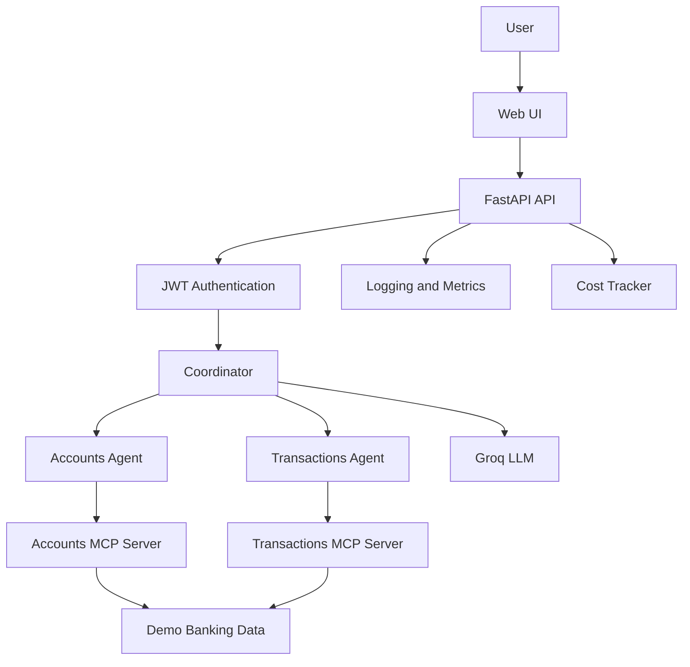

# Banking Support Agent

A read-only, multi-agent banking support chatbot built with **FastAPI, Groq, Python, and Model Context Protocol (MCP)**.

Authenticated demo users can ask questions about their accounts and transactions through a conversational interface.

## Features

- **Multi-agent architecture** — coordinator routes requests to specialized agents.
- **Accounts Agent** — lists accounts, retrieves balances, and provides supported credit-card information.
- **Transactions Agent** — retrieves recent transactions, searches transactions, and checks flagged transactions.
- **LLM integration** — Groq through an OpenAI-compatible API.
- **MCP integration** — banking data tools exposed through MCP servers.
- **Read-only design** — no transfers, payments, withdrawals, deposits, or account modifications.
- **Authentication** — JWT-based login with demo users.
- **Rate limiting** — limits login and chat requests.
- **Observability** — request IDs, logging, agent/tool timing, and metrics.
- **Cost tracking** — estimates LLM usage costs using configurable prices.
- **Web interface** — browser-based chatbot.
- **Testing** — unit tests and evaluation scripts.

## Architecture



## Available Banking Tools

### Accounts MCP Server
- `list_accounts`
- `get_balance`
- `get_credit_card_info`

### Transactions MCP Server
- `get_recent_transactions`
- `search_transactions`
- `get_flagged_transactions`

The Service MCP server currently has no active banking operations.

## Project Structure

```text
banking-agent/
├── app/
├── mcp_servers/
├── static/
├── tests/
├── evals/
├── deploy/
├── cli.py
├── requirements.txt
├── .env.example
└── README.md
```

## Requirements

- Python 3.11+
- Groq API key

## Setup (Windows PowerShell)

```powershell
python -m venv .venv
.\.venv\Scripts\Activate.ps1
pip install -r requirements.txt
Copy-Item .env.example .env
```

Configure your Groq API key and a secure JWT secret in `.env`.

Generate a JWT secret:

```powershell
python -c "import secrets; print(secrets.token_urlsafe(48))"
```

## Run

```powershell
python -m uvicorn app.main:app --host 127.0.0.1 --port 8001
```

Open http://127.0.0.1:8001/

## Demo Credentials

| Username | Password |
|---|---|
| alice | alice123 |
| bob | bob123 |

## Example Queries

- What are my account balances?
- Show my recent transactions.
- Search for my Amazon transactions.
- Are there any flagged transactions?
- What is my credit-card information?
- Transfer ₹5,000 to another account.

The application is read-only and rejects unsupported banking operations.

## API Endpoints

| Endpoint | Method | Purpose |
|---|---|---|
| `/` | GET | Chat
